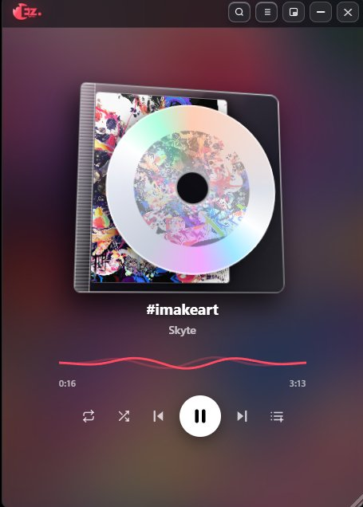
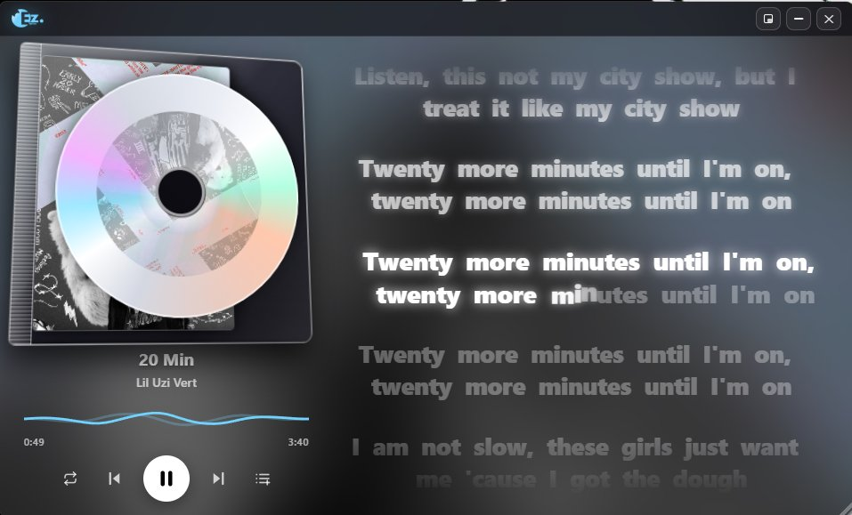
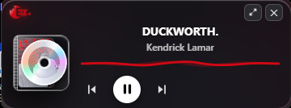

# EZ Lyrics

> A lightweight, fast lyrics overlay based on Python.

EZ Lyrics is a sleek, ultra-low resource floating companion overlay for Spotify. It tracks Spotify's live playback and displays millisecond-accurate synchronized lyrics with audio reactive visuals.

## Showcase

| Vertical Overlay | Real-Time Synced Lyrics | Mini HUD Mode |
|---|---|---|
|  |  |  |

### Video Previews
- [Full Playback & Lyrics Demo](https://files.catbox.moe/cp2pjl.mp4)
- [Overlay & Controls Demo](https://files.catbox.moe/28o6mf.mp4)

---

## Features

- **Spotify Companion**: Automatically syncs with your desktop Spotify client.
- **Synced Lyrics**: Line-by-line scrolling lyrics with phonetic Romanization sub-lines.
- **Smooth, reactive UI**: Real-time album artwork color tinting, draggable window, and size grips.
- **Audio Spectrum FFT**: Built-in 8-band audio visualizer wave reacting to output.
- **Ghost Mode (`Ctrl+Shift+L`)**: Click through the overlay directly into your underlying game or workspace.
- **Discord Status**: Displays your live track on Discord via rich presence.

---

## How It Works

EZ Lyrics listens to Windows media transport signals to detect Spotify's current song and position, matching and scrolling timestamped lyrics in an accelerated webview window.

---

## FAQ

**Does this require Spotify?**  
Yes. EZ Lyrics acts as a companion overlay for Spotify Desktop. For a standalone player without Spotify, check out [EZ Lyrics Player](https://github.com/IsthatNyte/ez-lyrics-player).

**Does this require Spotify Premium?**  
No. It works with both Free and Premium accounts by reading desktop media signals.

**Can I run it without installing Python?**  
Yes. Download the pre-built `EZ.Lyrics.exe` from the [Releases](https://github.com/IsthatNyte/ez-lyrics/releases) page.

---

## Quick Start

### Option A: Run Pre-Built Executable
Download `EZ.Lyrics.exe` from [Releases](https://github.com/IsthatNyte/ez-lyrics/releases) and double-click to launch alongside Spotify.

### Option B: Run from Source
```bash
git clone https://github.com/IsthatNyte/ez-lyrics.git
cd ez-lyrics
pip install -r requirements.txt
python app.py
```
